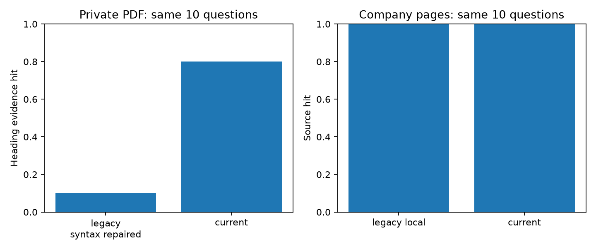
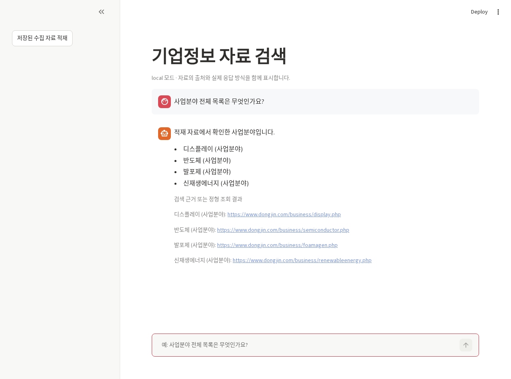
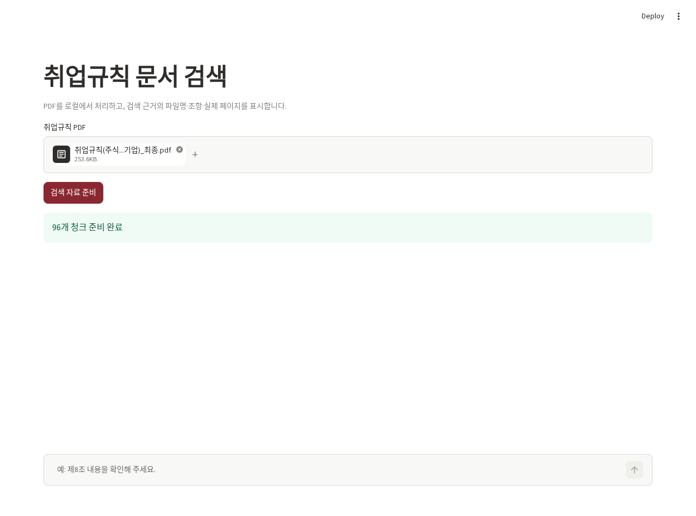

# 다중 도메인 자료 검색과 RAG 검증

기업 홈페이지·취업규칙·대학 자료의 검색 범위를 분리하고, 정형 목록과 생성형 답변을 구분해 검증한 프로젝트입니다.

## 문제 정의

문서를 검색했다고 질문에 정확히 답한 것은 아닙니다. 목록의 누락, 본문 참조를 새 조항으로 오인하는 분할, 페이지 근거 누락, 약한 근거를 강제로 반환하는 동작을 점검했습니다. 사용자 제공 코드와 자료를 실제 실행하고 실패 결과도 남겼습니다.

## 데이터와 공개 범위

- 기업정보: 제공된 동진 홈페이지 수집 JSON 19페이지. 새 수집은 robots.txt HTTP403으로 허용 상태를 확인하지 못해 19개 대상을 모두 건너뛰었습니다.
- 취업규칙: 제공 PDF 38쪽. 실제 원문·벡터 인덱스·검색 답변 본문은 추가 공개하지 않았습니다.
- 대학 자료: [순천향대 RAG](apps/sch/README.md)의 학과·입시·논문 자료. 문서·대화 이력·인덱스는 로컬에서만 검증했습니다.

main에 원래 존재하는 `data/pages.json`은 이 변경에서 수정하지 않았습니다. 기존 공개 원문의 재배포 권한은 별도 확인 대상입니다. 새 PDF·JSON 원문·대화 DB·모델 가중치·`.env`·API 키는 추가하지 않았습니다. 사용자는 이 자료로 직접 사내 강의를 진행했다고 확인했으며 교육용 예제와 완성된 실험을 구분했습니다.

## 기술 스택과 구조

Python 3.12, Chroma, LangChain, 한국어 로컬 임베딩, Ollama, Playwright, pypdf, Streamlit, pytest, Ruff를 사용합니다. 회사 정보의 기존 OpenAI API 모드는 코드상 유지하지만 이번 검증에는 사용하지 않았습니다. 모델 모드를 바꾸면 프로세스를 재시작하고 별도 인덱스를 준비해야 합니다. 취업규칙 앱은 로컬 임베딩과 localhost Ollama만 사용합니다.

```text
app.py / config.py / ingest.py / rag.py   기업정보 앱·설정·적재·라우팅
src/document_rag/                       공통 문서 변환·검색·응답·CLI
crawl/crawl_playwright.py               허용 상태 확인·수집·재시도·저장
configs/crawl_targets.json              기존 19개 공개 URL과 카테고리
apps/employment/                       비공개 PDF 검색 앱
apps/sch/                              학과·입시·논문 및 그래프 데모
evaluation/                            동일 질문셋 비교 스크립트
tests/                                 검색·조항·출처·크롤링 경계 테스트
results/                               집계 결과·그래프·실제 실행 화면
docs/                                  검증 과정·한계·포트폴리오 정리
```

## 분석 및 개발 과정

1. `dj_rag`와 로컬 버전을 비교했습니다. 로컬 버전에 이미 카테고리별 분산 검색과 질의 임베딩 재사용이 구현되어 있어 이를 새 성과라고 주장하지 않고 보존했습니다.
2. 수집/정제/적재/검색을 분리했습니다. 수집 결과에는 HTTP 상태, 시각, 원문 hash, 추출 selector, body fallback 여부를 남깁니다. 실패 페이지를 정상 문서로 적재하지 않습니다.
3. 문서 ID를 안정적으로 생성해 동일 자료의 반복 적재 시 청크와 임베딩을 불필요하게 늘리지 않습니다. 바뀐 원문을 예전 자료와 조용히 섞지 않고 별도 인덱스 생성을 요구합니다.
4. 취업규칙의 본문 `제N조` 참조와 실제 조항 헤더를 구분했습니다. 조항·부분 번호·실제 PDF 페이지와 원문 hash를 보존합니다.
5. 번호가 명시된 여러 조항은 전체 부분을 조회하고, 의미 검색으로 찾은 조항도 나머지 부분을 함께 가져옵니다. 긴 근거를 임의로 잘라 생성 결과로 표시하지 않습니다.
6. 검색 결과·추출식 fallback·생성 모델 응답을 표시하고, 검색 성공률을 답변 정확도로 바꾸어 표현하지 않습니다.

## 주요 결과

| 검사 | 기존 코드 | 수정 후 |
|---|---:|---:|
| 취업규칙 10문항: 지정 조항 헤더 반환 | 1/10 | 8/10 |
| 취업규칙 반환 근거의 페이지 기록 | 0/10 | 10/10 |
| 기업정보 10문항: 지정 URL 반환 | 10/10 | 10/10 |
| 기업 사업분야 4개 포함 | 4/4 | 4/4 |

취업규칙 원본 `rag.py`는 전체 들여쓰기 때문에 import되지 않습니다. 기존 비교는 **들여쓰기만 복구한 사본**을 실행한 진단입니다. 같은 원본 자료와 질문을 사용했지만 분할·거리 metric·검색 규칙이 함께 바뀌므로 한 수정의 효과로만 해석하지 않습니다. 헤더/URL 수준의 소규모 회귀 평가이며 법률 답변 정확도나 일반화 정확도가 아닙니다.

취업규칙은 96개, 회사 자료는 33개 청크를 생성했습니다. 두 번 적재해도 각각 96/33개를 유지했습니다. 실제 Playwright 로컬 fixture에서는 정상 페이지·503 재시도 성공·404 기록을 검증했습니다. **실사이트 신규 수집 성공은 0개**입니다.







## 실행

```bash
python -m venv .venv
source .venv/bin/activate
pip install -e .
playwright install chromium
```

CPU용 PyTorch 설치는 운영체제에 맞는 공식 설치 안내를 따르세요. 회사 앱은 기본 local 모드입니다. 기존 가공 자료를 별도로 준비한 후:

```bash
export DJ_PAGES_JSON=/path/to/private/pages.json
export DJ_INDEX_DIR=/path/to/private/company_index
python ingest.py
streamlit run app.py
```

취업규칙 PDF는 업로드 UI 또는 CLI를 사용합니다.

```bash
streamlit run apps/employment/app.py
# CLI의 질문 결과에는 원문이 포함될 수 있으므로 공개 로그에 저장하지 마세요.
document-rag --index /path/to/private/rules_index --collection employment \
  --input /path/to/private/rules.pdf
document-rag --index /path/to/private/rules_index --collection employment \
  --question '제8조와 제9조를 확인해 주세요.' --no-generation
```

로컬 생성 모델은 별도로 준비합니다. 검색만 검증할 때는 `--no-generation`을 사용합니다.

```bash
ollama pull gemma3:4b
ollama serve
```

크롤러는 robots 확인 실패·거부 시 수집하지 않습니다. `USER_AGENT`에 확인되지 않은 허가 문구를 넣지 않습니다.

```bash
python crawl/crawl_playwright.py --targets configs/crawl_targets.json \
  --output results/private/crawl.json
pip install -r requirements-dev.txt
pytest -q
ruff check app.py config.py ingest.py rag.py src crawl apps tests evaluation
```

원본 코드가 있는 로컬 사본으로 같은 비교를 실행하려면 [평가 스크립트](evaluation/evaluate_documents.py)의 CLI 인자를 사용합니다. [순천향대 실행법](apps/sch/README.md)은 별도 의존성과 자료 경로를 설명합니다.

## 검증 결과와 한계

RAG 전체 회귀 테스트 38개를 통과했습니다. 실제 PDF·회사 JSON 적재/검색, 두 앱의 브라우저 실행, Playwright 로컬 fixture를 확인했습니다. [상세 보고서](docs/document-validation.md)에 기존 코드 차이·검색/응답 지표·공개 제외·남은 오류를 기록했습니다.

취업규칙의 휴일·징계 질문에서 선택한 gold 헤더를 반환하지 못했고, 무관 질문 3개 중 1개에도 근거를 반환했습니다. 회사 질문은 명시적 범위 검사로 해당 3개를 보류하지만 더 다양한 질문에 일반화할지는 검증하지 않았습니다. 소규모 실제 생성 검증은 [별도 보고서](docs/generation-validation.md)에 기록했습니다. 일반적인 답변 정확도, 실제 정보 탐색 10분→3분, 실사이트 수집·동적 페이지 전체 성공은 검증된 성과로 표시하지 않습니다. 문서 재배포 권한, 독립 질문셋과 사람의 답변 검수가 후속 과제입니다.
