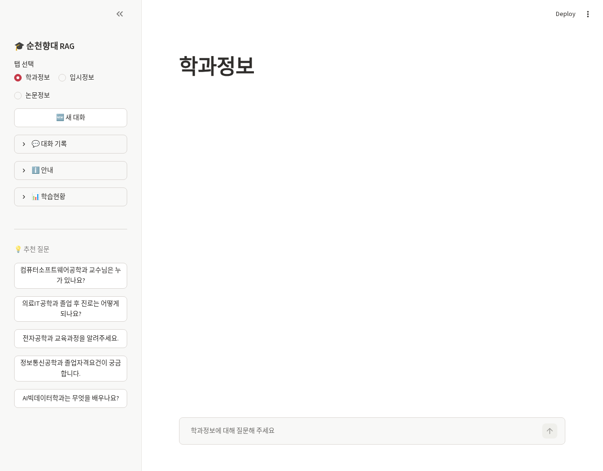
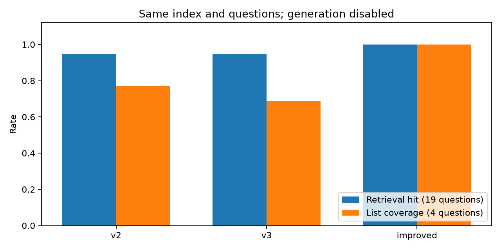

# 순천향대 다중 도메인 RAG

학과·입시·논문 자료를 도메인별로 검색하고, 정형 질문은 메타데이터·Neo4j로 처리하는 로컬 RAG 프로젝트입니다.

## 문제 정의

벡터 top-k만으로 전체 목록을 답하면 항목이 누락될 수 있습니다. 다른 학과로 검색을 넓히거나 임의의 검색 점수를 답변 정확도로 해석하는 것도 오류를 만듭니다. 문서 기반 설명과 정형 목록·속성 조회를 구분했습니다.

## 사용 데이터와 공개 범위

원본 ZIP의 학과 JSON, 2027 수시모집 PDF, 논문 PDF 5개 및 v3 Chroma 인덱스를 로컬에서 점검했습니다. 이 브랜치에는 해당 문서·JSON·인덱스·대화 이력·`.env`를 추가하지 않았습니다. 공개 가능한 자료를 직접 준비한 뒤 적재해야 합니다. 기존 데이터의 작성권·재배포 권한은 별도 확인 대상입니다.

사용자는 이 자료로 사내 강의를 직접 진행했다고 확인했으며 이력서에 교육 자료 준비와 8회 교육을 명시했습니다. `GUIDE`의 실습이라는 표현을 외부에서 제공받은 코드의 증거로 해석하지 않습니다. v2/v3 원본 및 이번 검증 변경은 `docs/sch-validation.md`에서 구분합니다.

## 기술 스택과 구조

Python, Streamlit, LangChain, Chroma, `jhgan/ko-sroberta-multitask`, Ollama `gemma3:4b`, Neo4j, FastAPI, pypdf, 선택적 Tesseract OCR을 사용합니다. 세 컬렉션은 같은 기반 모델을 사용하는 검색 범위 분리이며 각각 독립 학습한 LLM이 아닙니다.

```text
apps/sch/
  app_streamlit.py
  common/             설정·범위 검사·대화 이력
  ingest/             학과 JSON·PDF 파싱과 적재, 그래프 적재
  rag/                도메인 라우팅·검색·생성
  graph_demo/         입시 GraphRAG API와 화면
  requirements.txt
  .env.example
evaluation/evaluate_sch.py
tests/test_sch.py
results/sch/          집계 지표와 실제 실행 화면
```

## 개발 과정과 결과

v2/v3의 공통 UI·설정·가드·대화 이력은 동일합니다. v3는 입시 전형별 필터, PDF 표 열 경계와 큰 청크, 교수 검색 k 증가·학과장 우선 정렬, Neo4j 적재 및 그래프 데모를 추가·변경했습니다. 이번 검증에서는 목록 전체 조회, 필터 밖 fallback 차단, 중복 제거, fallback 출처 표시, PDF 연속 페이지 오분류, 그래프 근거 페이지 보존을 수정했습니다.

동일한 23문항과 v3의 동일 인덱스로 코드 차이를 비교했습니다. 관련 근거가 있는 19문항에서 retrieval hit는 v2/v3 18/19, 파일명 보조 단서 수정 후 19/19였습니다. 교수 목록을 확인할 수 있는 4문항의 항목 포함률은 v3 68.75%→개선 100%, 자료가 없는 교수 정보 및 범위 밖 질문의 올바른 응답 보류는 3/4→4/4였습니다. 이는 작은 회귀 평가이며 실제 대학의 전체 정보나 생성형 답변 정확도에 대한 수치가 아닙니다.

입시 PDF 필수 9개 필드 완전 추출은 19/21개 전형에서 20/21개로 늘었습니다. 지역의사선발전형의 복합 표형 모집인원은 단일 값으로 변환하지 않았습니다. [평가 절차와 실패 사례](../../docs/sch-validation.md)를 참고하세요.





## 실행

Python 3.12에서 검증했습니다. CPU용 PyTorch는 해당 운영체제의 공식 설치 안내를 따르세요.

```bash
pip install -r apps/sch/requirements.txt
cp apps/sch/.env.example apps/sch/.env
```

문서는 기본 `apps/sch/data/` 또는 환경변수 `SCH_DATA_DIR` 경로에 별도로 둡니다. `SCH_CHROMA_ROOT`로 인덱스 저장 경로를 바꿀 수 있습니다.

```bash
python apps/sch/ingest/ingest_department.py
python apps/sch/ingest/ingest_admission.py
python apps/sch/ingest/ingest_paper.py
ollama pull gemma3:4b
streamlit run apps/sch/app_streamlit.py
```

그래프 적재는 `NEO4J_URI`와 `NEO4J_PASSWORD`를 로컬 환경에 설정한 뒤 실행합니다. 제공된 `.env`를 Git에 추가하지 마세요.

```bash
python apps/sch/ingest/build_admission_graph.py --dry-run
python apps/sch/ingest/build_admission_graph.py
cd apps/sch
uvicorn graph_demo.app:app --host 127.0.0.1 --port 8000
```

`--reset`은 지정한 파생 인덱스·그래프를 삭제합니다. 원본 보존 경로에 설정하지 마세요. 적재 모델과 검색 모델을 바꿀 때는 별도의 인덱스를 재생성해야 합니다.

```bash
pip install -r requirements-dev.txt
pytest -q
ruff check apps/sch evaluation tests
python evaluation/evaluate_sch.py --project apps/sch \
  --index /path/to/private/copied/chroma_store \
  --output results/sch/local.json --label local
```

## 검증 한계와 후속 과제

실제 한국어 임베딩 로드·Chroma 검색·학과/입시 적재·Streamlit 브라우저 실행을 확인했습니다. Ollama 서버가 없어 `gemma3:4b` 답변 정확도와 전체 응답 지연은 측정하지 않았습니다. `USE_OLLAMA=0`의 추출식 fallback 결과를 LLM의 성능으로 세지 않습니다. Neo4j는 PDF 파싱과 API의 fixture 테스트를 수행했으며 실서버 적재·질의는 검증하지 않았습니다.

후속 과제는 별도 미사용 평가셋, 목록의 외부 정답 검수, 검색 점수 임곗값 보정, 긴 텍스트의 임베딩 잘림, 논문 주제 필터의 미사용 질문 평가, PDF 표 원문 대조 및 실제 생성 평가입니다.
