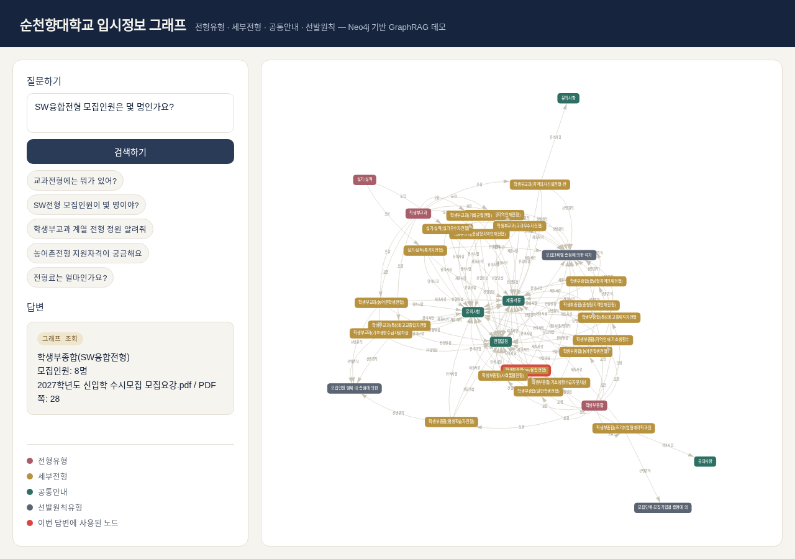

# 실제 로컬 생성 및 그래프 통합 검증

2026-11-12~13(한국시간)에 Ollama 0.40.16 CPU와 gemma3:4b(Q4_K_M)를 새 격리 컨테이너에서 실행했다. 모델 파일 SHA256을 검증했고 외부 추론 서비스를 호출하지 않았다. 사용자 홈 대신 작업 경로에 컨테이너 상태를 저장했다.

## 평가 범위와 재현

SCH 4문항(교수 목록·원서접수 일정·전형료·논문 키워드), 문서 4문항(취업규칙의 기간·시간·휴일·회사 설립연도)을 같은 질문과 원본 자료로 비교한다. SCH는 재구축한 동일 Chroma 인덱스를 두 코드에서 사용한다. 문서 비교는 동일 PDF/회사 JSON으로 만든 각 분할 방식의 인덱스를 사용한다. 기존 취업규칙 코드는 전체 들여쓰기만 복구했다.

고정 설정은 temperature=0, seed=42, num_ctx=8192, num_predict=192, num_thread=2다. 운영 기본값과 다른 제한된 진단 설정이며 출력 제한 중단을 실패 유형으로 기록한다. 각 버전을 새 Python 프로세스에서 순서대로 실행했다. 측정 시간은 해당 질문의 검색·생성 호출 시간이고, 첫 질문은 모델/인덱스 로드를 포함할 수 있다. Ollama 캐시 상태와 다른 검증 작업의 CPU 사용량을 통제하지 않았으므로 지연 수치로 성능 우위를 일반화하지 않는다.

```bash
python evaluation/evaluate_generation.py legacy sch \
  --originals /private/source --sch-baseline /private/sch_v3 \
  --runtime /private/runtime --private-output /private/audit/legacy_sch.json
# version: legacy/current, group: sch/documents
# 특정 수정 재검사: --case paper
```

테스트 의존성은 `pip install -r requirements-dev.txt`로 설치한다. CPU PyTorch와 OCR 언어팩·Ollama·Neo4j 서버는 별도 준비 대상이다.

runtime에는 sch_rebuilt_verified/{department,admission,paper}, employment_validated, company_validated, document_comparison/{pdf_legacy,company_legacy} 인덱스가 필요하다. 검색 비교 스크립트와 각 ingest로 준비한다. 출력 JSON은 답변·원문 근거를 포함하므로 저장소 밖 또는 results/private에만 저장한다.

정답 기준은 제공 문서에서 확인한 필수 사실/목록이다. 이번 검토에서는 AI 코드 리뷰어가 원문과 반환 근거·실제 답변을 대조했으며, 키워드 일치만으로 답변 전체를 정확하다고 세지 않는다. 이번 평가는 개발 중 발견한 사례를 포함한 소규모 회귀 점검이고 독립 시험셋·블라인드 전문가 평가는 아니다. 교수·논문 키워드의 정형 반환은 LLM 정확도와 분리한다. 논문 첫 페이지의 스캔 이미지를 직접 열어 추출된5개 키워드와 일치함을 확인했다. 사람 전문가의 독립 채점은 수행하지 않았다.

## 발견한 문제와 수정

- 기존 교수 답변에 연구실 정보가 섞이고 출력 제한에서 중단됐다. 전체 교수 메타데이터 조회는 생성 없이 항목을 유지한다.
- 전형명이 들어간 전형료 질문이 지원자격 페이지로 라우팅됐다. 공통 전형료 표를 우선 조회하도록 수정했다.
- 논문 키워드 답변에서 분류 알고리즘을 네트워크 지표로 잘못 설명했다. 추출 키워드가 있는 단순 목록은 메타데이터로 반환한다. 의미·설명·분석·차이 질문은 생성 경로를 유지한다. OCR/키워드 추출 오류까지 해결했다는 주장은 아니다.
- done_reason=length 응답을 완성된 답변으로 표시하지 않고 중단 안내와 별도 generation_mode를 반환한다.
- CPU 생성의 첫 토큰 대기를 고려해 문서 앱의 읽기 timeout을 OLLAMA_TIMEOUT_SECONDS(기본180초)로 설정 가능하게 했다. 전체 요청의 절대 시간 제한과는 다르다.

추가 문서 평가에서 질문의 두 항목 중 하나 누락과 존재하지 않는 근거 번호 인용을 발견했다. 각 항목을 간결하게 답하도록 프롬프트를 보완하고, 범위를 벗어난 [번호]를 생성하면 원문 근거로 fallback한다. 보완 후에도 근로시간 문항의 모델 인용 오류가 재발했으며 실제로 원문 fallback이 작동했다. 이를 생성 답변 성공으로 세지 않았다. 이 검사는 인용 번호의 존재 여부만 확인하며 해당 문장이 인용 원문에 의해 뒷받침되는지 자동 보장하지 않는다.

기존 기업정보 생성 중 Ollama unexpected EOF/HTTP500이1회 발생했다. 답변 오답으로 계산하지 않고 서버 오류로 기록한 뒤 같은 설정으로 별도 재시도했고 설립연도 답변을 확인했다. 최초 오류를 숨기거나 코드 오답으로 합산하지 않았다.

## Neo4j와 화면

원본 Neo4j는 연결 실패 상태이며 변경하지 않았다. 새 로컬 Neo4j Community 5.26.0에서 전형21개를 적재하고 반복 적재 후에도21개임을 확인했다. 전형 모두 source/pages가 존재한다. 실제 FastAPI는 학생부교과8개 목록과 SW융합전형 모집인원8명·PDF28쪽을 반환했다.

브라우저 실행에서 외부 그래프 CDN 실패를 발견했다. vis-network 9.1.9 배포본과 원본 Apache-2.0/MIT 라이선스를 보존하고 로컬 static으로 제공했다. 외부 HTTP를 차단한 Playwright에서도 canvas와 실제 DB 질의 답변이 표시됐다. 원래 운영 DB·인증·동시성 환경의 재현은 아니다.



## 최종 문항별 검토

| 문항 | 기존 코드 | 최종 코드 | 기존/최종 호출 초 |
|---|---|---|---:|
| 교수 목록 | 누락·혼합·중단 | 정형 조회로 전체 목록 | 150.33 / 7.94 |
| 원서접수 일정 | 필수 날짜 일치, 중단 | 필수 날짜 일치, 중단 | 156.80 / 150.75 |
| 전형료 | 근거 확인 불가 응답 | 필수 금액 일치 | 39.82 / 96.63 |
| 논문 키워드 | 키워드 오답 | 추출 키워드5개 정형 조회 | 198.52 / 15.22 |
| 수습기간 | 필수 사실 일치 | 필수 사실 일치 | 24.89 / 11.07 |
| 주당·하루 근로시간 | 근거 확인 불가 응답 | 인용 오류 감지 → 원문 표시 | 13.62 / 25.35 |
| 휴일 날짜 | 필수 사실 일치 | 필수 사실 일치 | 29.93 / 36.58 |
| 회사 설립연도 | 서버 오류 후 재시도 일치 | 필수 사실 일치, 과도한 인용 | 54.19 / 69.89 |

표의 시간은 재시도/수정 재검사에서 실제 측정한 값이다. 교수·키워드 정형 반환을 생성 정확도로 합산하지 않는다. 입시 일정은 필수 날짜가 맞아도 중단된 답변이며, 근로시간은 원문 fallback으로 처리한 실패다. 회사 답변의 번호3개는 모두 존재하지만 설립연도를 직접 포함한 청크는 첫 번째뿐이었다. 번호 검증은 사실별 인용 정확도를 보장하지 않으며 사람 검수와 별도 평가셋이 남아 있다.

[집계 JSON](../results/documents/generation_comparison.json)에 설정·지연·실패를 기록했다. 평가 중간 답변과 원문은 비공개로 보존했으며 불리한 시도를 삭제하고 성공한 시도만 평균하지 않았다.
